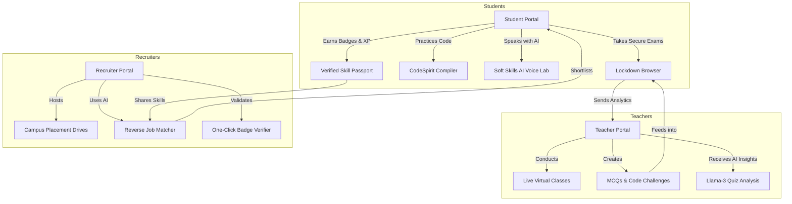

# StudySpirit: The AI-Driven Unified EdTech & Placement Ecosystem
**A Pitch Deck, Startup Business Proposal & Executive Technical Report**  
*Prepared for the Meeting with the Pro-Chancellor*

---

## 1. Executive Summary & Startup Vision

**StudySpirit** is a next-generation B2B2C EdTech and HRTech startup designed to solve the single largest bottleneck in higher education: **the fragmentation between learning, assessment, and hiring.**

Traditional universities use a disconnected stack of tools:
*   **Moodle/LMS** for hosting files.
*   **LeetCode/HackerRank** for coding practice.
*   **MS Teams/Zoom** for online classes.
*   **HireVue/AMCAT** for mock interviews.
*   **Superset/Emails** for placement management.

This disconnected workflow results in **resume fraud, high recruiter verification costs, and student disengagement**. 

**StudySpirit unifies this entire pipeline into a single platform.** From Day 1 of the 1st Semester to Placement Day, every lecture attended, quiz taken, code compiled, and mock interview completed feeds into a single, tamper-proof, AI-validated **Skill Passport**. This passport is shared directly with verified employers who recruit candidates based on real-time competency data, completely bypassing traditional resume filtering.

```
┌────────────────────────────────────────────────────────┐
│                    STUDYSPIRIT ENGINE                  │
├────────────────────────────────────────────────────────┤
│ Semester 1 ──────> Continuous ──────> Secure ──────> Placement│
│  Onboarding          Learning         Exams           AI-Match │
└────────────────────────────────────────────────────────┘
```

---

## 2. The Three Stakeholder Pillars

The startup operates as a three-sided ecosystem connecting **Students, Teachers, and Recruiters** around a single source of truth.



### Pillar A: The Student (Gamified Career Accelerator)
Students are guided through a gamified learning roadmap with continuous feedback:
1.  **Animated Concept & Resources Lab:** Dynamic visual courses and interactive examples replacing boring PDFs.
2.  **CodeSpirit Compiler Engine:** A sandboxed compiler supporting Python, JS, C++, C, Java, and TS, allowing students to practice coding challenges directly.
3.  **AI Voice Lab (Soft Skills):** An interactive, speech-to-text AI mentor powered by Llama 3 70B. It conducts real-time voice interviews, evaluates speech clarity, and corrects grammar dynamically (*e.g., "Not like this, this is the correct way to speak: [Correction]"*).
4.  **Secure Exam Client:** Fully locked-down environment ensuring high-stakes exam integrity.
5.  **Skill Passport:** A public, shareable profile containing cryptographically verifiable badges and scores earned through code challenges and exams, eliminating the need to write resumes.

### Pillar B: The Teacher (Smart Classroom & Proctoring Center)
Teachers get an automated dashboard that handles the manual overhead of class management:
1.  **Smart Classrooms & Virtual Study Rooms:** Tools to schedule lectures, broadcast announcements, and launch live video/audio rooms (`Group Mode`).
2.  **AI Assessment Creator:** Automatically generates MCQ quizzes and coding challenges of varying difficulties.
3.  **Llama-3 Quiz Insights:** Rather than just showing grades, the backend AI analyzes quiz results and generates instant pedagogical reports for the teacher (*e.g., "Class is struggling with pointers in C++. We recommend reviewing memory allocation patterns."*).
4.  **Growth Tracker:** Analytics tracing student competency curves from the 1st semester to final year.

### Pillar C: The Recruiter (Precision Hiring & Fraud Elimination)
Instead of searching on generic job sites, recruiters work in tandem with the university's ecosystem:
1.  **Direct Campus Drive Console:** Recruiters schedule campus drives targeting specific batches and attach custom pre-hiring assessments.
2.  **AI "Reverse-Match" Engine:** Recruiters upload their Job Description. The integrated AI (Llama 3.1 70B) reads the job requirements, scans the students' verified Skill Passports, and outputs the top 5 matches with detailed matching reasons.
3.  **One-Click Verified Hiring:** Students apply with a tap. Recruiters receive pre-verified test scores, code samples, and AI interview transcripts, eliminating resume screening entirely.
4.  **Badge Verification Portal:** Public verification page where recruiters can enter a badge hash to verify student credentials directly.

---

## 3. Core Technical Architecture & Innovations

### Innovation 1: The StudySpirit Lockdown Browser (`studyspirit-browser`)
A custom Electron-based desktop application that acts as a secure container for university examinations.

*   **Process Killer:** Checks active operating system processes. It automatically flags or terminates screen recorders, virtual cameras, and remote desktop tools (e.g., OBS, Zoom, AnyDesk, Teams, Discord, VNC).
*   **Kiosk Fullscreen:** Locks the desktop environment. Students cannot minimize, exit fullscreen, press `Alt+Tab`, `Win+D`, or use system shortcuts.
*   **Anti-Screenshot & Clipboard Wipe:** Intercepts print-screen keys (`PrtScn`, `Win+Shift+S`) and clears the operating system clipboard upon exam initialization to prevent question leakage.
*   **Virtual Machine (VM) Detection:** Inspects underlying hardware information (system MAC addresses, BIOS serials, disk controller signatures) to detect hypervisors like VMware, VirtualBox, and Hyper-V.
*   **Network Request Interception:** Intercepts outgoing HTTP calls to block internet searches while keeping API traffic to `studyspirit.in` allowed.
*   **Telemetry Heartbeat:** Sends encrypted JSON logs containing browser state, hardware hashes, and active processes to the backend every 30 seconds.

### Innovation 2: Sandboxed Coding Execution Engine (CodeSpirit Compiler)
*   **Multi-Language Compiler:** Powered by the Wandbox API, executing C, C++, Python, Java, JavaScript, and TypeScript.
*   **Concurrency Gateway (Memory Queue):** Employs an in-memory queue to limit execution concurrency, shielding third-party compilation microservices from rate limits during high-traffic exams.
*   **Execution Caching:** Caches identical compilation runs for 5 minutes, significantly reducing server overhead.
*   **Autonomous Test Runner:** Validates student code submissions against target test cases. On passing all test cases, it automatically updates the student's database entry.

### Innovation 3: Speech & Llama-3 AI Pipelines
*   **AI Conversation Partner:** Integrates `SpeechRecognition` (speech-to-text) and `SpeechSynthesis` (text-to-speech) on the frontend with a custom backend controller routing requests to Groq (Llama-3-70B).
*   **Structured Outputs:** Implements strict JSON schema enforcement on AI calls. The AI responds with structured objects separating dialogue (`reply`), teaching corrections (`corrections`), and grading metrics (`readinessScore`).
*   **AI Recruiter Matching:** Combines student Mongo schemas (scores, profiles, university metadata) into an dynamic context payload parsed by Llama-3-70B to evaluate job fit scores.

---

## 4. The Business Model (SaaS + Placement Commission)

StudySpirit monetizes through a highly scalable hybrid model:

1.  **University Enterprise SaaS:** Annual licensing fee paid by universities to replace LMS, proctoring software, and placement management software with one single platform.
2.  **Recruiter Placement Commission:** Recruiters pay a subscription or commission fee for the "AI Reverse Match" and direct access to pre-verified, cheat-proof student cohorts.
3.  **Student Upskilling (Premium):** Students get basic curriculum courses for free; premium dynamic animation labs, advanced AI interview preparation, and specialized mock assessments are available as a subscription.

---

## 5. Talking Points for the Pro-Chancellor Meeting

Use these targeted bullet points to drive the value proposition during your presentation:

### Point 1: Academic Rigor & Absolute Exam Integrity
> *"Sir, today students easily cheat on online exams using browser tabs, chat tools, or remote assistance. StudySpirit includes a custom-built secure desktop browser that blocks Alt+Tab, kills cheating programs like OBS, AnyDesk, or Zoom, and checks if the student is using a virtual machine. This ensures that every test score in our college database is 100% genuine."*

### Point 2: Massive Improvement in Campus Placements
> *"Instead of pushing resumes to generic job boards, StudySpirit is a closed-loop network. Recruiters are directly integrated. They can post jobs, and our system's AI reads their Job Description, scans student codes, scores, and mock interview performances, and matches them instantly. It makes our students visible to recruiters from Day 1 based on real skills, not resume keywords."*

### Point 3: Reduced Workload for Teachers
> *"Our teachers spend hundreds of hours grading, making exams, and checking assignments. With StudySpirit, the AI automatically creates coding exams and quizzes. More importantly, it gives the teacher a diagnostic report of where the batch is struggling. It acts as an automated teaching assistant."*

### Point 4: A Resume-Free Campus (The Skill Passport)
> *"We track student performance continuously from the 1st semester up to placements. All code, exams, and soft skill scores are cryptographically verified. We present recruiters with a 'Skill Passport' containing verified skill badges. There is zero scope for resume manipulation, which makes our university the most trusted hiring partner."*

---
*Created by StudySpirit Startup Team*
